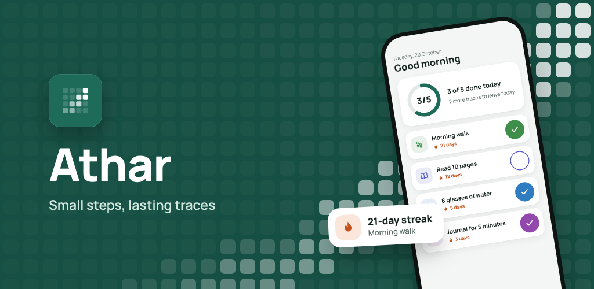
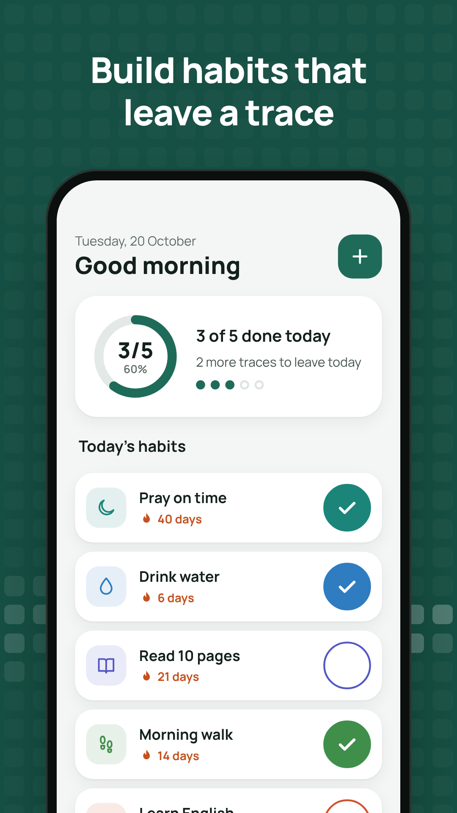
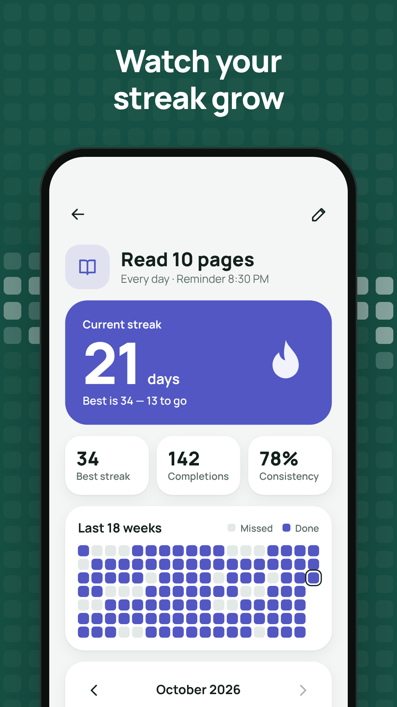
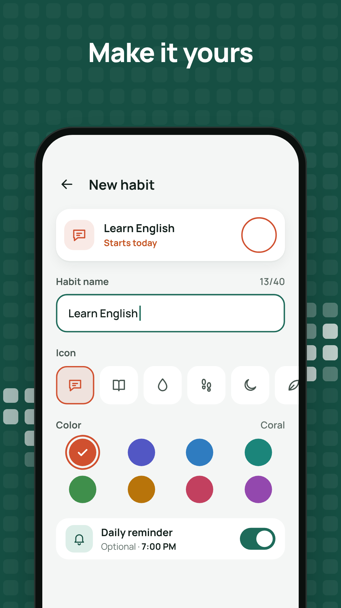
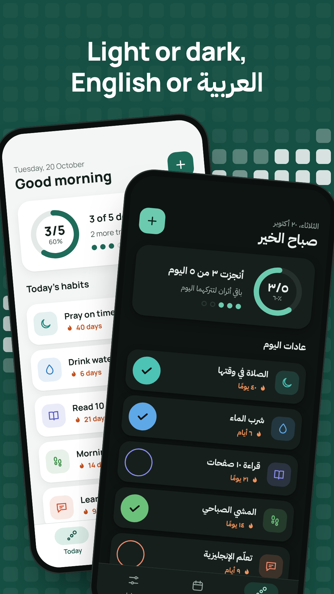
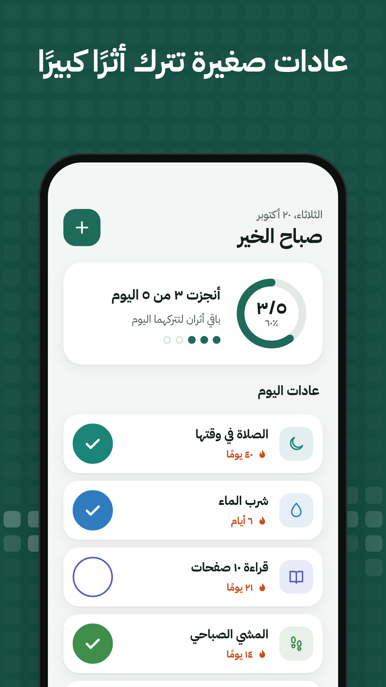
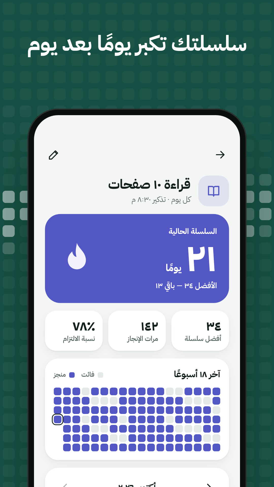
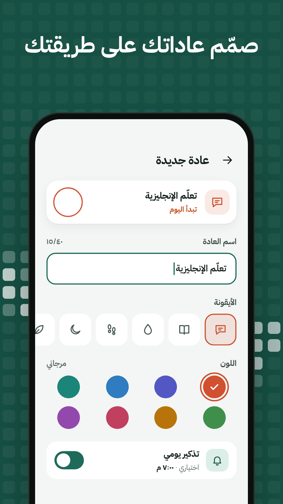
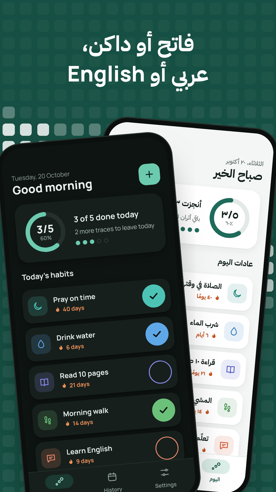

# Athar (أثر)

A calm, bilingual (English/Arabic) habit tracker for Android and iOS, built with Flutter.

Add daily habits, check them off, keep streaks going, and see your history as a heatmap and a monthly calendar. Everything stays on the device: no accounts, no network access, no analytics. Optional daily reminders use local notifications.

- Full Arabic: right-to-left layout, Arabic-Indic digits, Arabic plural forms, weeks starting on Saturday
- Light and dark themes; phone, tablet, and wide layouts
- Streaks (current and best) computed from completion dates, with milestone celebrations

## Screenshots

<table>
  <tr>
    <th></th>
    <th>Home</th>
    <th>Habit Details</th>
    <th>Add Habit</th>
    <th>Language/theme</th>
  </tr>
  <tr>
    <th>English</th>
    <td></td>
    <td></td>
    <td></td>
    <td></td>
  </tr>
  <tr>
    <th>العربية</th>
    <td></td>
    <td></td>
    <td></td>
    <td></td>
  </tr>
</table>

## Stack

| Area | Packages |
|---|---|
| State | flutter_bloc (Cubit), equatable |
| DI | get_it (`lib/core/di`) |
| Routing | go_router (`lib/core/router`) |
| Storage | hive_ce + hive_ce_flutter (habits), shared_preferences (settings) |
| Localization | easy_localization, `assets/translations/{en,ar}.json` |
| Notifications | flutter_local_notifications, timezone, flutter_timezone, app_settings |
| UI | flutter_svg, flutter_slidable, bundled Cairo font |
| Tooling | flutter_launcher_icons, flutter_native_splash, hive_ce_generator, build_runner |

Architecture is feature-first clean architecture: `lib/features/{onboarding,habits,settings}/{data,domain,presentation}`, with shared code in `lib/core/`. See `CLAUDE.md` for the project rules and `design/screens.md` for the UI spec.

## Run

Requires Flutter 3.47 or later (Dart ^3.13).

```sh
flutter pub get
flutter run
```

Debug builds have a few developer tools that are compiled out of release builds. Long-press the Home greeting to insert sample habits, fire a test reminder, reset onboarding, or open the design test screen.

After changing a Hive model (`lib/features/habits/data/models`), regenerate the adapters:

```sh
dart run build_runner build --delete-conflicting-outputs
```

## Test

```sh
flutter analyze   # must report zero issues
flutter test
```

Streak rules are covered in `test/features/habits/domain`.

## Icons and splash

The launcher icon is configured in `flutter_launcher_icons.yaml` (sources in `assets/icons/launcher/`):

```sh
dart run flutter_launcher_icons
```

The native splash is configured in `flutter_native_splash.yaml` (sources in `assets/splash/`; that file explains how to re-export the PNGs from the SVGs):

```sh
dart run flutter_native_splash:create
```

The localized home-screen name ("Athar" / "أثر") lives in `android/app/src/main/res/values{,-ar}/strings.xml` and `ios/Runner/{en,ar}.lproj/InfoPlist.strings`.

## Release build (Android)

### 1. Create the upload keystore (once)

```sh
keytool -genkeypair -v \
  -keystore ~/keys/athar-upload.jks \
  -storetype JKS -keyalg RSA -keysize 2048 -validity 10000 \
  -alias upload
```

Keep the keystore outside the repository and back it up, along with its passwords. If you lose it, you have to ask Google to reset the upload key.

### 2. Create `android/key.properties` (gitignored)

```properties
storeFile=/home/YOU/keys/athar-upload.jks
storePassword=YOUR_STORE_PASSWORD
keyAlias=upload
keyPassword=YOUR_KEY_PASSWORD
```

`storeFile` must be an absolute path, or a path relative to `android/app/`. Without this file, release builds fall back to the debug key, and Play rejects debug-signed bundles.

### 3. Build

Bump `version:` in `pubspec.yaml` first (the `+N` build number must go up for every upload), then:

```sh
flutter build appbundle --release --obfuscate --split-debug-info=build/symbols
```

- Bundle: `build/app/outputs/bundle/release/app-release.aab`
- Dart symbols: `build/symbols/`. Archive this folder for every release (for example as `athar-<version>-symbols.zip`). Without it, obfuscated Dart stack traces can't be decoded:

  ```sh
  flutter symbolize -i stacktrace.txt -d build/symbols/app.android-arm64.symbols
  ```

R8 shrinking is on for release. `android/app/src/main/res/raw/keep.xml` keeps the notification icon (`ic_stat_athar`), which is only referenced from Dart.

Store listing text, the privacy policy, and Data safety answers are in `store/`.

## License

Copyright (c) 2026 Ahmed Waheed. All rights reserved. This project is proprietary and not open source: no permission is granted to use, copy, modify, or distribute its code, assets, or designs without prior written permission. See [LICENSE](LICENSE).

### Third-party licenses

The notice above covers only this project's own work. The bundled Cairo font is licensed under the SIL Open Font License (see [`assets/fonts/Cairo/OFL.txt`](assets/fonts/Cairo/OFL.txt)), and the Dart and Flutter packages the app depends on are distributed under their own licenses.
